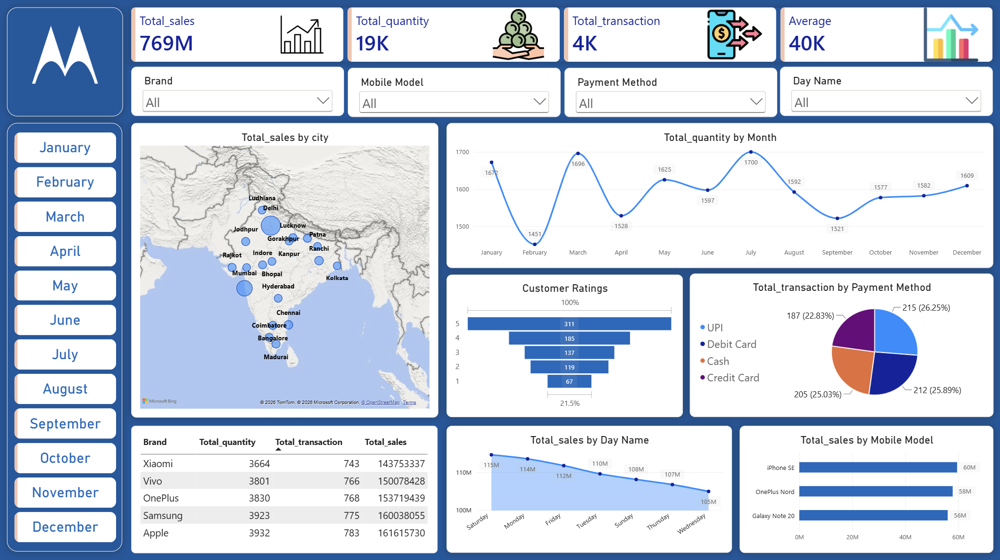

# 📱 Mobile Sales Analysis Dashboard | Power BI

An interactive Power BI dashboard designed to analyse mobile phone sales performance, customer behaviour, and purchasing trends.

This project explores sales insights across different brands, mobile models, cities, payment methods, and customer ratings through interactive visualisations.

> **Project Type:** Guided Practice Project  
> **Tool:** Microsoft Power BI  
> **Domain:** Sales Analytics

---

## 📌 Project Overview

The **Mobile Sales Analysis Dashboard** provides an overview of mobile phone sales from 2021 to 2024.

The dashboard helps explore business performance through key metrics and interactive visualisations, making it easier to understand sales trends, customer preferences, and product performance.

This is my first Power BI practice project, recreated independently by following a tutorial from **Satish Dhawale (Founder of SkillCourse)** as part of my Data Analytics learning journey.

## 🎯 Project Objectives

The main objectives of this project are to:

- Analyse overall mobile sales performance.
- Compare sales performance across different mobile brands.
- Identify top-performing mobile models.
- Understand customer payment preferences.
- Analyse monthly and day-wise sales trends.
- Explore city-wise sales distribution.
- Evaluate customer ratings and purchasing behaviour.

## 📂 Dataset Overview

The dataset contains mobile phone transaction records with information about products, sales, customers, and payment methods.

| Dataset Attribute | Details |
|---|---|
| Total Records | 3,835 |
| Total Columns | 14 |
| Number of Brands | 5 |
| Number of Cities | 19 |
| Date Range | 2021–2024 |

**Dataset Source:** Provided by Satish Dhawale as part of the SkillCourse Power BI tutorial.

## 🛠️ Tools & Technologies

| Tool / Technology | Purpose |
|---|---|
| Microsoft Power BI | Dashboard development and data visualisation |
| Microsoft Excel | Data inspection and preparation |
| DAX | Creating calculated measures and KPIs |

## 📊 Dashboard Features

### 1. Key Performance Indicators (KPIs)

- Total Sales
- Total Quantity Sold
- Total Transactions
- Average Unit Price

### 2. Sales Performance Analysis

- Brand-wise sales comparison.
- Mobile model-wise sales analysis.
- Monthly quantity trends.
- Day-wise sales performance.

### 3. Customer & Payment Analysis

- Customer rating analysis.
- Payment method distribution.
- Customer purchasing preferences.

### 4. Geographical Analysis

- City-wise sales distribution using map visualisation.
- Comparison of sales performance across 19 cities.

### 5. Interactive Filters (Slicers)

Users can explore the dashboard using the following filters:

- Month
- Brand
- Mobile Model
- Payment Method
- Day Name

## 🧮 DAX Measures

The following DAX measures were created to calculate the dashboard's key performance indicators.

**1. Total Sales**

```dax
Total_sales =
SUMX(
    'Sales Data',
    'Sales Data'[Units Sold] *
    'Sales Data'[Price Per Unit]
)
```

**2. Total Quantity**

```dax
Total_quantity =
SUM('Sales Data'[Units Sold])
```

**3. Total Transactions**

```dax
Total_transaction =
COUNTROWS('Sales Data')
```

**4. Average Unit Price**

```dax
Average =
AVERAGE('Sales Data'[Price Per Unit])
```

## 📚 Key Learnings

Through this project, I gained practical experience in:

- Developing interactive dashboards in Power BI.
- Creating DAX measures for business KPIs.
- Working with different data visualisation techniques.
- Analysing sales and customer-related data.
- Implementing slicers and interactive filters.
- Presenting information through data visualisation and storytelling.

## 📸 Dashboard Preview



## 🙏 Acknowledgements

Special thanks to **[Satish Dhawale](https://www.linkedin.com/in/satish-dhawale/), Founder of SkillCourse**, for providing the tutorial and guidance that helped me complete this practice project.

This dashboard was recreated independently as part of my ongoing journey towards becoming a Data Analyst.

---

⭐ **First Power BI Practice Project | Data Analytics Portfolio**

